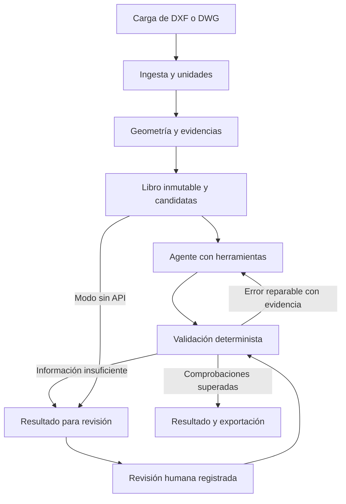

# Arquitectura de Vexplorer

> Estado documental (2026-11-14): este archivo conserva requisitos y checkpoints históricos; las frases sobre ausencia de aplicación o contratos pendientes no describen el estado vigente. Consulta [README](../README.md) y la auditoría completa. Las reglas de coordinación y arquitectura siguen aplicándose.

> **Alcance actualizado:** las referencias a P0 y al contrato 0.1.0 describen el hito técnico T1–T10. La prueba de concepto completa exige además T11–T13: inferencia desde planos pobres, histórico y estimación. Véase [CASO_DE_USO_Y_EVALUACION](CASO_DE_USO_Y_EVALUACION.md). Las ampliaciones siguen pendientes de implementación y acuerdo de contratos.

**Estado:** especificación para implementar. **Versión propuesta del contrato:** 0.1.0, pendiente de acuerdo A/B y aviso C. **Fecha:** 13 de noviembre de 2026.

Este documento adopta la arquitectura facilitada por el equipo: frontend, FastAPI, ingesta DXF/DWG, geometría determinista, herramientas, agente ligero, validación y salida trazable. La incorporación del corpus real se documenta en [DATASET.md](DATASET.md). La auditoría de datos no equivale a tener la aplicación implementada.

## 1. Objetivo y límite de la interpretación

Convertir un plano vectorial de mobiliario en una lectura revisable: vistas, cotas, candidatos a componentes, significado propuesto y documentación visual. El despiece se entrega únicamente donde el dibujo respalda identidad, dimensiones y cantidades. Un resultado parcial que conserva lo desconocido es un resultado previsto.

Separar dos niveles semánticos: **objeto completo** (mesa, sofá, puerta arquitectónica) y **componente** (tablero, lateral, balda). El corpus mecánico auxiliar combina piezas individuales CAD con conjuntos en PDF. PlankAssembly añade referencias paramétricas de mobiliario descargadas, con vistas por generar. No demuestra automáticamente el despiece de un mueble ni determina cantidades de conjunto a partir de un archivo de componente. `entity_level=object|unknown` no entra en `pieces`. Las dimensiones generales permanecen como mediciones del plano, sin renombrar altura como espesor.

El alcance P0 del despiece es mobiliario rectangular de tableros y dibujos vectoriales suficientemente informativos. Los 14 CAD reales sirven para lectura de unidades, cotas, vistas y abstención; el despiece de paneles se verifica con un fixture propio. Los 51 paquetes de conjuntos PDF requieren el piloto P1 descrito en [ADAPTACION_DATASET](ADAPTACION_DATASET.md). Los casos de fabricación deben seleccionarse y anotarse; pueden complementarse con fixtures propios. No se reconstruye de manera general un sólido a partir de cualquier proyección.

## 2. Decisiones adoptadas

| Decisión | Motivo | Consecuencia |
|---|---|---|
| DXF como entrada P0 | El corpus ya ofrece DXF emparejados con DWG | La demo no depende de convertir DWG |
| ODA opcional P1 | Es una aplicación externa que debe estar instalada y comprobada | Fallo explícito `conversion_unavailable`; alternativa DXF |
| Geometría antes del agente | La interpretación necesita hechos medibles | Se congela un libro de evidencias por revisión |
| Tool use nativo con proveedor configurable | Mantener un bucle y adaptador pequeños | Sin LangChain ni framework multiagente |
| Agente propone referencias y etiquetas | Separar inferencia de medidas | El backend resuelve los números finales |
| Validador único para revisión y entrega | Evitar caminos con distintas reglas | `validar_borrador` y `entregar_despiece` comparten servicio |
| SQLite y artefactos locales | Un host y un equipo en el hackathon | Trabajo serializado; sin prometer alta disponibilidad |
| JSON y CSV P0; exportación PDF P1 | Priorizar el recorrido completo | La exportación es independiente del futuro lector PDF |
| Entrada PDF como piloto P1 | Los conjuntos recibidos están en PDF | Requiere procedencia por página/región y asociación de referencias |
| Cajas 3D esquemáticas | Visualizar dimensiones respaldadas | No certifican ensamblaje ni colisión física |

La documentación de [ezdxf/ODA](https://ezdxf.readthedocs.io/en/stable/addons/odafc.html) requiere un conversor instalado. Conservar su versión, entrada y salida en un manifiesto; no afirmar lectura nativa de DWG por ezdxf.

## 3. Flujo principal

1. Guardar el original y calcular SHA-256; el texto CAD no se interpreta como instrucciones.
2. Convertir solo si es DWG y el conversor está disponible; guardar hashes distintos si los bytes cambian.
3. Resolver unidades, transformaciones, espacios y tipos soportados. Unidades desconocidas detienen las medidas métricas.
4. Detectar vistas y observaciones; proponer asociaciones entre vistas sin multiplicar piezas por proyecciones.
5. Crear mediciones, candidatos y alternativas. Cada número apunta a evidencias; cada asociación registra su estado.
6. Congelar `candidate_revision`. El agente puede inspeccionar y proponer; no alterar la fuente.
7. Validar referencias, identidad, agrupaciones y restricciones aplicables.
8. Persistir resultado, informe y traza. Resolver cifras desde las referencias al generar la salida.

## 4. Módulos y límites

Las siguientes rutas son **código futuro**, no archivos de aplicación presentes en este paquete.

| Ruta prevista | Responsabilidad | Prohibición clave |
|---|---|---|
| `backend/app/ingesta/` | Upload, formato, conversión, manifiesto | No ejecutar comandos indicados por un plano |
| `backend/app/geometria/` | Unidades, contornos, cotas, vistas, candidatos | No rellenar dimensiones ausentes con valores típicos |
| `backend/app/agente/semantica/` | Interpretación y recuperación semántica sobre hechos calculados | No equiparar parecido y equivalencia de fabricación |
| `backend/app/contratos/modelos.py` | Tipos y validación estructural | No aceptar campos extra silenciosamente |
| `backend/app/herramientas/` | Funciones autorizadas y esquemas generados desde Pydantic | No ejecutar argumentos como código ni conceder permisos al modelo |
| `backend/app/agente/` | Proveedor, bucle, presupuestos, caché | No escribir geometría ni publicar texto libre como resultado |
| `backend/app/validador/` | Reglas R-001…R-018 propuestas | No confundir desconocido y falso |
| `backend/app/api/` | Transacciones, resultados, autorización, HTTP/SSE y cancelación | No sobrescribir resultados ni bloquear el event loop con CAD |
| `backend/app/salida/` | JSON/CSV desde resultados persistidos | No recalcular por otra ruta las medidas |
| `frontend/` | Plano, selección, tabla, traza, cajas | No modificar datos geométricos para hacerlos encajar |

## 5. Datos y estados

Los modelos Pydantic de `contratos/` serán la única autoridad de campos. [CONTRATOS_DATOS.md](CONTRATOS_DATOS.md) es una propuesta documental previa al acuerdo A/B, con aviso C. Generar los esquemas JSON desde los modelos y contrastar los consumidores del frontend; no mantener otra autoridad manual.

Estados de ejecución: `queued`, `ingesting`, `extracting`, `reasoning`, `validating`, `completed`, `needs_review`, `failed`, `cancelled`, `timed_out`. Los cinco últimos son terminales. `completed` exige al menos una pieza respaldada, cobertura y ninguna incógnita obligatoria; no es una certificación de fabricación. Las etiquetas propuestas siguen identificadas como propuestas.

Si hay un ledger íntegro pero ninguna propuesta aceptable, el servidor valida y persiste una abstención con Result revisión 1. Un ledger sin candidatas produce revisión explícita R-018; un ledger inválido produce fallo técnico. Así la salida temprana conserva un resultado revisable sin promover borradores inválidos.

Una revisión humana crea `result_revision+1`. `Run.state` conserva el desenlace original; `Result.state` refleja el resultado revisado. Un cambio de unidades, archivo o configuración de vistas exige otra ejecución y otro fingerprint. No se reabre una traza que terminó en `run_finished`.

## 6. Ejecución y persistencia

Un único worker del servicio reclama trabajos de SQLite mediante una transacción. El análisis CAD se ejecuta fuera del event loop y con límite temporal; para operaciones que deben poder terminarse, usar un proceso controlado. Un hilo cancelado lógicamente no garantiza detener una llamada nativa bloqueada.

Persistir `documents`, `runs`, `results`, `reviews`, `events` y los metadatos de artefactos. Guardar originales fuera del árbol público del frontend. La traza SSE procede de eventos persistidos con secuencia creciente. Reconectar no debe reiniciar ni duplicar el trabajo.

Al reiniciar el proceso, marcar ejecuciones interrumpidas con error explicable; permitir un nuevo run explícito. No anunciar reanudación durable automática mediante `BackgroundTasks`. [FastAPI distingue tareas de fondo y trabajo pesado](https://fastapi.tiangolo.com/tutorial/background-tasks/); la estrategia concreta de recuperación aquí es una decisión del proyecto.

## 7. Límites iniciales de servidor

| Configuración | Valor inicial |
|---|---:|
| `max_upload_bytes` | 20 971 520, 20 MiB por CAD individual |
| `max_entities` | 100 000, contando expansión controlada |
| `ingest_timeout_s` | 60 |
| `oda_timeout_s` | 30, dentro de ingesta |
| `max_model_calls` | 15, incluidos intentos fallidos/reintentos |
| `max_tool_calls` | 30 |
| `max_validation_repairs` | 2 |
| `run_timeout_s` | 120 para fase agéntica |
| `abs_tol_mm` | 0,1 |
| `rel_tol` | 0,000001 |

Son decisiones configurables, no tiempos medidos ni tolerancias de fabricación. El ZIP de dataset es un corpus de trabajo: su tamaño no cambia el límite del endpoint de CAD individual. El cliente no puede elevar estos presupuestos.

## 8. Visualización fiel

GET ledger y GET drawing exponen evidencia y un `DrawingPreview` con mapeo de IDs. La selección enlaza `piece → candidate → observation → contour → source_entity`. Si no hay unidades, el dibujo se muestra en coordenadas fuente, sin afirmar mm. Resaltar todas las vistas asociadas a una pieza. Una cota de otra vista se muestra en su marco correspondiente, no sobre una posición arbitraria.

Las cajas se generan solo si están respaldadas las tres dimensiones. Su disposición en cuadrícula o explotada es una transformación de presentación. Una vista montada necesita posiciones justificadas; sin ellas, rotular «despiece esquemático». Una altura de un objeto completo no rellena un espesor de tablero.

## 9. Extensiones posteriores

P1: piloto PDF de entrada Bench Vise, exportación PDF, conversión DWG verificada, cadenas dimensionales con premisas estructuradas y más primitivas. En P0 R-015 y colisiones físicas son `not_applicable`. P2: MCP, más familias de muebles, aprendizaje con etiquetas revisadas y análisis de ensamblaje con información suficiente. Cada extensión conserva los mismos límites entre observación, hipótesis y hecho confirmado.

## 10. Criterio de entrega del MVP

Un archivo admitido produce una lectura trazable; una decisión semántica dudosa puede revisarse; las medidas publicadas se reproducen; el resultado se guarda y exporta; los fallos tienen un estado visible. Casos concretos en [TEST_PLAN.md](TEST_PLAN.md), ejecución en [PLAN.md](../PLAN.md).

## Flujo adicional requerido para la prueba de concepto

T11 incorpora escenarios de descomposición separados del ledger de observaciones: piezas/secciones propuestas → revisión humana → premisas versionadas → nueva validación. Una propuesta puede señalar regiones de origen sin afirmar un contorno de componente observado. La ausencia de prueba dimensional conserva hipótesis e incógnitas; no obliga a ocultar toda propuesta útil.

T12 añade módulos futuros `backend/app/historico/` y `backend/app/estimacion/`. El primero recupera comparables desde un catálogo permitido; el segundo calcula escenarios de coste/horas con referencias, tarifas y supuestos identificados. El agente solicita herramientas y explica resultados; el código calcula. Congelar versión del índice/modelo de embeddings, catálogo, reglas económicas y revisión del despiece en cada estimación. Cambiar cualquiera invalida su caché.

Los originales y referencias de evaluación reservadas no pertenecen al repositorio accesible por herramientas. La UI y exportación distinguen hechos, propuestas y estimación provisional. Los estados 0.1.0 de Run/Result no certifican aceptación económica ni de fabricación; estas ampliaciones requieren contratos versionados.

## Frontera de preparación de PlankAssembly

El futuro preparador de [PlankAssembly](PLANKASSEMBLY.md) opera fuera del proceso de inferencia: programa paramétrico → vistas del conjunto y manifiesto privado → paquete 2D por caso. El evaluador conserva cuboides, asociaciones y respuesta; el agente solo puede inspeccionar la entrada permitida. El motor de producto no consulta ese programa para rellenar medidas ausentes.

Registrar revisión, generador, proyecciones y escala en la procedencia; convertir DXF y verificar unidades es trabajo pendiente. Añadir PlankAssembly al almacenamiento local no habilita una entrada JSON nueva de la API ni entrena un modelo. Recuperación geométrica futura y presupuestación con histórico económico siguen como módulos distintos.
