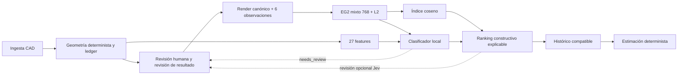
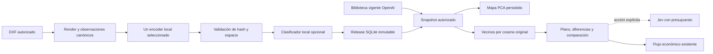

# Diseño de arquitectura de producción para búsqueda semántica

Fecha: **2026-11-14**. Estado: **arquitectura objetivo con un incremento de exploración integrado en main; no desplegado**. Las secciones 1–11 describen el diseño de `dbd1bb6`; la sección 12 distingue el incremento concreto y sus límites. La decisión que gobierna este diseño se documenta en [Decisión de arquitectura de producción](DECISION_ARQUITECTURA_PRODUCCION.md).

Este documento concreta cómo incorporar la evidencia del laboratorio al producto sin convertir resultados exploratorios en garantías industriales. Mantiene las reglas vigentes: la geometría y la estimación son deterministas, las medidas proceden del ledger y de revisión humana, las vistas no son cantidades, y Pydantic sigue siendo la única fuente de verdad de los contratos.

## 1. Decisiones de diseño

1. **Recuperación:** EmbeddingGemma 2 mixto, 768 dimensiones, normalización L2 y coseno, sin PCA. La entrada experimental que se debe reproducir es el render canónico más las seis observaciones geométricas globales; no el texto completo del harness.
2. **Clasificación:** un clasificador separado consume el embedding L2 de 768 dimensiones y las 27 características geométricas. La regresión logística con `StandardScaler` ajustado sólo sobre train y `C=0,1` es un candidato inicial para una taxonomía amplia, no una configuración productiva congelada. Debe volver a seleccionarse y calibrarse sobre el corpus empresarial.
3. **Segundo dictamen:** Jev visual puede asistir una revisión opcional. No mide, no modifica el ledger, no genera embeddings, no decide por autoridad propia y no sustituye el clasificador local.
4. **Ranking:** el coseno propone candidatos; señales constructivas y filtros de compatibilidad los reordenan y explican. Categoría, similitud visual y equivalencia económica son señales diferentes.
5. **Economía:** sólo un histórico revisado, con alcance y versión económica compatibles, puede alimentar una estimación. El cálculo final permanece determinista y trazable.

## 2. Evidencia medida y ampliaciones propuestas

### 2.1 Medido en el laboratorio

- EG2 mixto 768 + kNN5, sin PCA, obtuvo macro-F1 0,8261 en el test core y 0,7780 en el test CAD adicional; son etiquetas editoriales proxy y tests ya observados.
- En la comparación local retrospectiva, kNN siguió ganando en core. En las 16 categorías adicionales ganó regresión logística sobre EG2 + 27 features, con `C=0,1`, macro-F1 0,8445 y balanced accuracy 0,8604 en test post hoc.
- Jev 1.14 visual obtuvo macro-F1 0,9143 en core y 0,5249 en CAD adicional. Rechazó 13 de 14 planos mecánicos en la elección abierta con imagen, pero ese conjunto no calibra detección OOD general.
- La app admitió 53 archivos en la prueba offline, pero produjo cero piezas y cero propuestas; ingesta no equivale a comprensión útil.
- La correspondencia entre vistas de PlankAssembly obtuvo Hit@1 0,30. No se ha demostrado recuperación robusta de un mismo objeto entre vistas.
- Los precios y horas no se validaron. Los comparables heredados son sintéticos y están desconectados de la biblioteca semántica.

Las cifras anteriores proceden de [Metodología](METODOLOGIA.md), [Clasificadores locales](COMPARACION_CLASIFICADORES_LOCALES.md), [Comparación con Jev](COMPARACION_JEV.md) y [Auditoría y datos](AUDITORIA_Y_DATOS.md). No son SLA, umbrales de aceptación ni autorización de despliegue.

### 2.2 Propuesto, aún no probado

- Reproducir en el runtime la entrada mixta exacta del laboratorio y verificar paridad de bytes y vectores.
- Entrenar, calibrar y seleccionar el clasificador con etiquetas empresariales, separación por fabricante/proyecto/familia y un test industrial ciego.
- Añadir abstención/OOD y una cola `needs_review`; la confianza actual no está calibrada.
- Conectar vecinos revisados con histórico económico versionado y ranking constructivo.
- Generalizar el proveedor OpenAI/texto y su caché actuales a proveedores multimodales y espacios vectoriales versionados.
- Introducir despliegues atómicos de modelo e índice, shadow mode, piloto y canary con criterios medidos.

En particular, el **texto completo del harness no se probó** como entrada de EG2. Incorporarlo sería otro experimento y crearía un espacio de embedding distinto. Asimismo, cambiar kNN por regresión logística puede cambiar etiquetas predichas, pero **no cambia los vecinos** del índice EG2.

## 3. Flujo objetivo de extremo a extremo

### 3.1 Ingesta, geometría y ledger

- La ingesta conserva documento, unidades, hash de contenido y procedencia.
- El motor geométrico produce observaciones, contornos, evidencias y candidatos antes de cualquier modelo semántico.
- Cada render y feature se liga a `run_id`, `result_revision`, versión del extractor y hash de entrada.
- Un documento puede contener planta, alzado, lateral, escenas o varios muebles. Las vistas se mantienen como observaciones del documento: nunca se convierten automáticamente en unidades físicas ni cantidades de BOM.
- Valores ausentes, ambiguos o en conflicto permanecen desconocidos; ningún modelo semántico los rellena con valores típicos.

### 3.2 Puerta de revisión

El indexado económico sólo admite una revisión coherente con el uso previsto. Un resultado `needs_review`, una corrección pendiente, una familia desconocida o un alcance económico incompleto pueden indexarse en un espacio exploratorio si se conserva ese estado, pero no deben convertirse en referencia de precio elegible.

Cada revisión nueva invalida los derivados de la anterior para uso activo: render, features, embedding, clasificación, vecinos materializados y estimaciones. Los artefactos anteriores pueden conservarse como historial inmutable y auditable, pero no mezclarse silenciosamente con la revisión vigente.

### 3.3 Representación e indexado

El adaptador de representación objetivo recibe sólo:

- PNG canónico producido por una versión identificada del renderer;
- las seis observaciones globales en formato estable;
- la identidad completa de la versión de modelo, pesos, precisión, preprocesado y dimensión.

El vector de 768 componentes debe ser finito, no nulo y normalizarse L2 antes de persistir. No se aplica PCA. La búsqueda inicial será exacta por producto escalar/coseno sobre vectores normalizados. Sólo se migrará a ANN cuando mediciones con el volumen real demuestren la necesidad; esa migración debe medir recall respecto del índice exacto, latencia y coste con el mismo conjunto de consultas.

### 3.4 Clasificación y abstención

El pipeline candidato concatena `EG2_L2[768]` y `geometry[27]`, ajusta `StandardScaler` sólo con train y entrena regresión logística balanceada. Scaler, orden de features, taxonomía y estimador forman un único artefacto versionado.

`C=0,1` es sólo una semilla de selección: ganó en CAD adicional, mientras que kNN ganó en core. El corpus propio debe comparar al menos el baseline kNN y la logística mediante validation independiente. Ninguna `predict_proba` se presenta como confianza fiable hasta calibrarla y evaluarla por taxonomía.

La salida operativa distingue:

- `classified`: decisión dentro de una versión de taxonomía;
- `needs_review`: evidencia insuficiente, posible OOD, conflicto entre señales o política conservadora;
- `provider_error`: fallo técnico, nunca reinterpretado como desconocido.

Hasta validar una política de abstención y un clasificador automático, toda etiqueta del modelo es una **propuesta sujeta a revisión**, no una clasificación aceptada. El servidor sí puede detectar de forma determinista entradas inválidas o incompatibles —dimensión, finitud, versión de espacio, esquema o revisión—, pero todavía no puede identificar de manera fiable que una entrada válida sea OOD semántico. Una señal débil o conflictiva se dirige a `needs_review`; no se inventa un umbral global a partir de los 14 planos mecánicos.

### 3.5 Ranking constructivo

El retrieval devuelve candidatos por coseno dentro del mismo `vector_space_id`. Después, un ranker determinista y explicable aplica:

1. exclusiones de compatibilidad acordadas (versión, alcance, material/proceso cuando sean requisitos) y autorización del catálogo;
2. similitud constructiva sobre componentes, dimensiones conocidas, espesor, material y cantidades confirmadas;
3. cobertura de datos y diferencias explícitas;
4. coseno como señal de forma/contexto visual;
5. clasificación predicha sólo como faceta o bonificación propuesta, no como sustituto de relevancia ni filtro duro.

Un filtro duro por categoría sólo es válido cuando la clase está confirmada por revisión o el usuario la elige explícitamente. Una predicción automática no debe eliminar vecinos y reducir silenciosamente el recall. Los pesos del comparador actual son manuales y sus controles son sintéticos. Antes de promoverlos, se necesitan juicios humanos de relevancia separados para apariencia, construcción, material y proceso. Un vecino de la misma categoría no es necesariamente fabricable del mismo modo ni económicamente comparable.

### 3.6 Histórico y estimación

El histórico elegible se enlaza a una revisión aceptada y conserva, como mínimo, proyecto/familia, alcance, moneda, fecha, coste real, precio ofertado, horas, material, acabado, mecanizados y versión de tarifas. Los vecinos sólo proponen referencias; una política determinista valida compatibilidad y registra por qué cada referencia entra o sale.

La estimación consume piezas confirmadas, alcance explícito y referencias económicas compatibles. Sus fórmulas, tarifas, redondeos y supuestos son versionados. EG2, el clasificador y Jev nunca generan importes, dimensiones u horas. Si faltan datos económicos compatibles, el resultado es desconocido o `needs_review`, no una extrapolación opaca.

## 4. Módulos objetivo

Los nombres siguientes son una propuesta de límites, no archivos ya implementados:

| Módulo | Responsabilidad | No debe hacer |
|---|---|---|
| `semantic/rendering` | Render canónico y seis observaciones con hashes de procedencia. | Inferir etiquetas o cantidades. |
| `semantic/providers` | Interfaz de encoder y adaptador EG2 local/servidor. | Acoplar secretos o transporte a contratos de dominio. |
| `semantic/vector_spaces` | Validación L2, identidad de espacio y compatibilidad. | Comparar espacios/versiones distintos. |
| `semantic/index` | Alta, baja y consulta exacta por coseno; futura interfaz ANN. | Aplicar reglas económicas. |
| `semantic/classification` | Scaler, clasificador, calibración y política de abstención. | Cambiar vecinos o escribir revisión humana. |
| `similarity/ranking` | Filtros y reranking constructivo explicable. | Tratar coseno como probabilidad. |
| `semantic/review_assist` | Dictamen Jev opcional con presupuesto y trazabilidad. | Medir, modificar ledger o aprobar automáticamente. |
| `historico/repository` | Versiones revisadas y hechos económicos. | Mezclar costes incompatibles o sintéticos sin marca. |
| `estimacion` | Cálculo determinista desde hechos confirmados. | Consultar modelos generativos para inventar valores. |

El runtime actual tiene `OpenAIEmbeddingProvider`, `EmbeddingSettings`, `embedding_cache`, `LibraryItem` y comparación semántica de texto. Esas piezas se **generalizan**, no se reutilizan fingiendo compatibilidad: hoy el proveedor acepta texto, el contrato fija `provider="openai"`, y la clave de caché no incluye imagen, revisión de pesos ni preprocesado multimodal.

## 5. Persistencia e identidades

### 5.1 Identificadores mínimos

Cada derivado debe referenciar identidades inmutables:

- `source_content_hash`, `run_id`, `result_revision`;
- `renderer_version` y `observation_schema_version`;
- `embedding_model_id`, revisión/hash de pesos, precisión y `preprocessing_version`;
- `vector_space_id`, que cubre modalidad, dimensión, normalización y ausencia/presencia de PCA;
- `feature_schema_id` para las 27 columnas y su orden;
- `taxonomy_version`, `classifier_release_id` y `calibration_version`;
- `index_release_id` y conjunto exacto de miembros;
- `ranking_policy_version` y `economic_policy_version`.

Una caché sólo acierta si coincide toda la identidad de entrada y transformación. No se reutilizan vectores entre `furniture-v*`, proveedores, revisiones de pesos, renders, precisiones, dimensiones o preprocesados distintos.

### 5.2 Almacenes propuestos

- **Artefactos:** renders, manifiestos, scaler/clasificador y metadatos verificables por hash; sin secretos.
- **Vectores:** embedding, `vector_space_id`, identidad de revisión y estado activo/retirado.
- **Índice:** snapshot inmutable construido desde un conjunto declarado de vectores.
- **Dominio:** resultados, revisiones, ledger, biblioteca e histórico económico en el repositorio transaccional.
- **Auditoría:** eventos de generación, publicación, consulta, revisión, invalidación, borrado y rollback.

El índice no es la fuente de verdad. Se puede reconstruir desde el almacén de vectores y el manifiesto de release.

### 5.3 Revisión, invalidación y borrado

- Una nueva `result_revision` crea nuevos derivados; nunca sobrescribe la identidad anterior.
- La revisión activa retira del índice activo la revisión reemplazada mediante una publicación atómica.
- Un borrado elimina la elegibilidad de consulta inmediatamente y programa el borrado de render, features, vector, caché y réplicas conforme a la política acordada; el evento de borrado conserva sólo la evidencia mínima permitida.
- Un modelo retirado no borra automáticamente sus vectores históricos, pero éstos quedan fuera de releases activos y sujetos a retención.
- Reindexar no resucita entradas retiradas: el manifiesto se construye desde registros activos y autorizados.

### 5.4 Aislamiento de catálogo y autorización

Cada registro, vector, entrada de caché, revisión e índice pertenece a un `catalog_scope` autorizado (por ejemplo, organización/proyecto y ámbito de datos). El servidor resuelve la identidad y permisos antes de generar la consulta y restringe la búsqueda al scope permitido; no recupera globalmente para filtrar sólo después. La respuesta se vuelve a validar contra la autorización vigente antes de entregarse, porque los permisos pueden cambiar durante la consulta.

La clave de caché y el manifiesto del índice incluyen el scope de autorización. Un release no puede mezclar catálogos incompatibles. La revocación de acceso o el borrado retira inmediatamente el elemento de resultados elegibles y desencadena invalidación de cachés e índices afectados. Ni una reconstrucción ni un rollback pueden reactivar revisiones borradas, retiradas o ya no autorizadas: todo manifiesto y puntero de release se valida contra el estado de autorización actual al publicar y al consultar.

## 6. Contratos de servicio propuestos

Estos contratos describen capacidades; no autorizan aún endpoints ni cambios en `backend/app/contratos/modelos.py`.

| Operación | Entrada esencial | Salida esencial |
|---|---|---|
| `build_semantic_representation` | `run_id`, `result_revision`, identidades de renderer/modelo | hashes de entrada, 27 features, vector validado y `vector_space_id` |
| `classify_revision` | revisión, `classifier_release_id` | clase/taxonomía, score bruto, calibración, estado y motivos de revisión |
| `search_similar` | identidad autorizada, scope, vector o revisión, `index_release_id`, filtros, límite | vecinos autorizados, coseno, diferencias, cobertura y versiones |
| `rank_constructive` | consulta, candidatos, política | ranking, exclusiones y desglose de señales |
| `request_review_assist` | revisión/render autorizado, taxonomía, presupuesto | dictamen Jev, abstención/error y procedencia |
| `select_economic_references` | revisión aceptada, candidatos históricos, política | referencias elegibles/rechazadas con motivos |
| `estimate` | revisión, referencias y política económica versionadas | conceptos deterministas, supuestos y trazabilidad |

Las respuestas deben incluir versiones y motivos, no sólo un score. Deben rechazar de forma explícita espacios incompatibles y revisiones obsoletas. La autorización se aplica antes de recuperar y se vuelve a comprobar sobre la respuesta; los filtros de negocio no sustituyen los controles de acceso.

Los modelos Pydantic existentes siguen siendo la única fuente de verdad y de ellos se deriva JSON Schema. Incorporar estos nuevos contratos o ampliar `EmbeddingMetadata`/`LibraryItem` requiere el acuerdo explícito A/B y aviso a C exigido por [CLAUDE.md](../../CLAUDE.md); **ese acuerdo no forma parte de este diseño y aún no se ha realizado**.

## 7. Jev como asistencia opcional

Jev se invoca sólo en servidor, detrás de una política explícita: por muestreo, conflicto entre señales o solicitud de revisión. La credencial vive en el gestor de secretos/entorno del servidor; nunca llega al navegador, logs, cachés, argumentos, artefactos ni repositorio.

Cada llamada declara modelo, hash de payload, hash de imagen, taxonomía, motivo, consumo y presupuesto. Se aplican límites de concurrencia, intentos y gasto. Agotar el presupuesto o fallar el proveedor degrada a revisión local; no bloquea geometría ni produce una aprobación implícita. El render enviado debe cumplir las reglas de datos y retención del proyecto.

Su respuesta es una observación de revisión. No puede:

- crear o alterar medidas, evidencias, piezas o cantidades;
- escribir una revisión aprobada;
- generar el vector de búsqueda;
- decidir el histórico o el precio;
- transformar `OTHER`/`UNKNOWN` o un error de API en una clase conocida.

## 8. Release, rollback y operación segura

Modelo e índice se publican como una pareja compatible y atómica: `classifier_release_id`, `vector_space_id`, `index_release_id`, taxonomía y política de ranking. Un puntero de release selecciona la pareja activa; los artefactos son inmutables y verificables por hash. Si la activación falla, el puntero no cambia.

El rollback mueve el puntero a la pareja anterior completa. No combina clasificador nuevo con índice o taxonomía antiguos ni puede recuperar datos borrados, revisiones retiradas o permisos revocados. Antes de activarse, el release anterior se revalida contra el catálogo y las ACL vigentes. Feature flags independientes permiten desactivar clasificación, reranking o Jev y conservar recuperación exacta o el flujo determinista existente.

La progresión propuesta es:

1. **Replay offline:** paridad de inputs, hashes y resultados reproducibles.
2. **Shadow:** produce resultados sin afectar respuestas, revisión ni estimación.
3. **Piloto revisado:** técnicos evalúan vecinos, etiquetas, abstenciones y referencias económicas.
4. **Canary:** una fracción controlada usa el release, con rollback probado.
5. **Ampliación:** sólo si los criterios previamente aprobados se cumplen en datos reales.

No se fijan aquí SLA ni números de promoción: latencia, calidad, cobertura, error, coste y carga se medirán primero. Los criterios concretos deben aprobarse antes de observar el holdout o el canary correspondiente.

## 9. Plan de validación antes de producción

### 9.1 Datos y partición

- Corpus propio con revisión técnica y procedencia/licencia compatibles.
- Separación por `manufacturer_id`, `project_id` y `product_family_id`, no sólo por archivo o nombre. `product_family_id` significa una familia de diseño y sus variantes, no una clase de la taxonomía.
- Holdout industrial sin inspección por quienes seleccionan representación, features, hiperparámetros, calibración o umbrales.
- Las clases conocidas que se puntúen deben estar representadas en train, sin colocar vistas o variantes de la misma familia en otros splits. Diseños o familias de diseño nuevos dentro de esas clases miden generalización en el test cerrado; las clases nuevas o los dominios fuera de la taxonomía forman una cohorte OOD separada.
- Casos multiobjeto, varias vistas, anotaciones, escalas, rotaciones, geometría no soportada y dominios ajenos.

### 9.2 Pruebas por capacidad

- **Paridad:** mismos bytes de render y seis observaciones que el experimento, acreditados por hashes exactos; normalización L2 y 768 dimensiones. La paridad de vectores se comprueba con una tolerancia numérica fijada antes de medir y documentada por precisión (incluido BF16/float), dispositivo y runtime, sin exigir igualdad binaria entre dispositivos cuando no corresponda.
- **Retrieval:** relevancia humana por pares/listas, con etiquetas separadas para apariencia, construcción, material y proceso; Precision/Hit/coverage y análisis por familia.
- **Clasificación:** macro-F1, balanced accuracy, matriz por clase y calibración; comparación contra kNN; cobertura y riesgo de `needs_review`.
- **OOD:** cohortes ajenas definidas antes del test; errores del proveedor separados de abstenciones.
- **Ranking:** preferencia técnica y razones de exclusión, sin usar categoría proxy como verdad de relevancia.
- **Economía:** precios, costes y horas se evalúan en un corpus distinto, con fecha, moneda y alcance; error económico no se infiere de métricas semánticas.
- **Operación:** releases atómicos, incompatibilidades, invalidación por revisión, borrado, reconstrucción de índice, flags y rollback.
- **Seguridad:** secretos sólo en servidor, payloads autorizados, límites Jev y ausencia de datos sensibles en logs/cachés.

Los tests unitarios deben cubrir validación y determinismo; los de integración, el flujo revisión→representación→índice→ranking; y los de aceptación, el holdout industrial y el corpus económico. No se simula el motor geométrico para afirmar calidad end-to-end ni se presenta una implementación falsa como resultado de este documento.

## 10. Decisiones cerradas y parámetros pendientes

### 10.1 Decisiones de construcción ya elegidas

Este diseño sí permite implementar el adaptador EG2, el espacio mixto 768 L2 sin PCA, el índice exacto por coseno, el pipeline de clasificación separada, el versionado, la invalidación y el modo shadow de sólo lectura. Estas piezas conservan las fronteras de autoridad y no requieren fijar todavía umbrales comerciales.

La implementación debe respetar desde el inicio el aislamiento por catálogo, las ACL en servidor, la no reactivación de datos retirados y la trazabilidad de revisión. Cualquier modelo Pydantic nuevo o cambio de contrato sigue bloqueado hasta el acuerdo explícito A/B y aviso a C; documentar esta arquitectura no constituye ese acuerdo.

### 10.2 Parámetros de negocio antes de activar producción

Antes de que los resultados afecten búsquedas visibles, revisión, selección económica o estimaciones deben aprobarse:

- taxonomía y significado de cada clase;
- política de revisión, calibración y tratamiento de cohortes OOD;
- definición y anotación de relevancia constructiva;
- esquema, permisos y aislamiento del histórico económico;
- retención y borrado de renders, vectores y respuestas externas;
- objetivos de promoción medidos, presupuesto Jev y condiciones de despliegue;
- ubicación operativa de EG2 y requisitos de licencia e infraestructura.

Hasta esa aprobación, el adaptador, índice y shadow pueden construirse y medirse, pero no presentarse como una capacidad productiva validada.

## 11. Referencias locales

- [Resumen del laboratorio](README.md)
- [Metodología](METODOLOGIA.md)
- [Auditoría y datos](AUDITORIA_Y_DATOS.md)
- [Clasificadores locales](COMPARACION_CLASIFICADORES_LOCALES.md)
- [Comparación con Jev](COMPARACION_JEV.md)
- [Prueba de la app con otros datasets](PRUEBA_APP_OTROS_DATASETS.md)
- [Prueba de embeddings con otros datasets](PRUEBA_EMBEDDINGS_OTROS_DATASETS.md)
- [Decisión de arquitectura de producción](DECISION_ARQUITECTURA_PRODUCCION.md)
- [Contratos Pydantic actuales](../../backend/app/contratos/modelos.py)
- [Proveedor y caché actuales](../../backend/app/semantic/embeddings.py)
- [Similitud actual](../../backend/app/similarity/service.py)
- [Repositorio actual](../../backend/app/servicios/repository.py)
- [Histórico sintético actual](../../backend/app/historico/service.py)
- [Estimación determinista actual](../../backend/app/estimacion/service.py)

## 12. Explorador integrado, modelos y visualización

La ampliación parte de `83df72d`, que integra laboratorio y aplicación autónoma. La [síntesis de investigación](INTEGRACION_EXPLORADOR.md) traza EX-01–EX-12 hasta la transcripción, contratos, auditorías y ramas. El [inventario](INVENTARIO_DOCUMENTAL.md) identifica los 112 Markdown revisados. Los informes del laboratorio describen sus snapshots históricos; [MUEBLE_GENERAL](../MUEBLE_GENERAL.md) e [HISTORICO_REAL](../HISTORICO_REAL.md) describen las capacidades posteriores que esta integración conserva.

### 12.1 Componentes concretos

| Componente | Implementación | Frontera |
|---|---|---|
| Modelos y validación | `backend/app/semantic_explorer/models.py` | Pydantic aditivo; no cambia contratos compartidos de inferencia. |
| Proyección y vecinos | `core.py` | L2/coseno en dimensión original; PCA centrada solo visual. |
| Persistencia | `store.py`, `semantic_explorer.sqlite3` | Releases inmutables por hash, activación transaccional, retiradas, imágenes, proyecciones y presupuesto. |
| Biblioteca y API | `service.py`, `router.py` | Revisión actual, separación de espacios, snapshot exigido, autenticación global. |
| Clasificación numérica | `classification.py` y publicador | kNN/logística durante publicación; parámetros numéricos, resultados no calibrados. |
| Segunda opinión | `review.py` | Jev opcional por acción explícita; sin escritura en ledger ni histórico. |
| Preparación | `tools/prepare_semantic_explorer.py` | DXF nuevo → render 384 + seis observaciones/27 features → encoder local existente. |
| Portabilidad y entrenamiento | `tools/stage_semantic_explorer.py`, `tools/train_semantic_classifier.py` | Copia acotada de corpus legado y receta fija sobre train; JSON numérico ligado al espacio/features. |
| Publicación | `tools/publish_semantic_explorer.py` | Verifica artefactos, clasifica opcionalmente, publica/activa/extiende/retira. |
| Interfaz | `frontend/explorer.html`, `explorer.js`, `explorer.css` | Mapa, lista, inspección, ranking, comparación entre modelos y exportación. |
| Copias | `tools/backup.py` | Añade SQLite semántica a las bases opcionales y su restauración. |

### 12.2 Versionado y estabilidad

`Space` identifica proveedor, modelo, revisión, modalidad, dimensión, precisión, normalización y preprocesado. El importador deriva la identidad de renderer/encoder/configuración; los espacios heredados OpenAI declaran su revisión como gestionada por proveedor y conservan la versión del descriptor. Esa limitación heredada no se oculta con un hash ficticio de pesos.

Cada `Entry` tiene ID local al catálogo, contenido, revisión si existe, atributos conocidos, procedencia de categoría y propuesta de clasificación opcional. `content_hash` permite contrastar el mismo contenido entre representaciones sin asumir identidad porque coincida un nombre. No establece identidad física de muebles ni relación con costes.

El `snapshot_id` incluye fuente/release, espacio, miembros y proyección. La proyección se persiste para estabilizar autovalores degenerados entre plataformas. Los filtros de UI no recalculan las coordenadas; publicar otro snapshot sí puede mover puntos. Casos vacíos, unitarios e idénticos no reciben ruido artificial. La varianza explicada no es un porcentaje de precisión semántica.

### 12.3 Contratos y revisión

Las rutas bajo `/api/v1/semantic-explorer` son `GET spaces`, `GET snapshot`, `POST search`, `GET image` y `POST review`. Búsqueda, imagen y dictamen exigen espacio, miembro y snapshot. Una revisión/retirada incompatible provoca conflicto o ausencia explícita. La respuesta vuelve a comprobar el snapshot vigente. La UI ignora respuestas tardías de selecciones anteriores.

Los vectores permanecen en servidor. Las imágenes son PNG admitidos, con límite de tamaño, hash, `nosniff` y sin caché del navegador. El navegador no puede suministrar rutas de archivos ni un catálogo externo a la instancia. Labels y datos del plano se insertan como texto, no como HTML.

Clasificar al publicar reutiliza el coste de inferencia para todas las consultas. `needs_review` significa propuesta no calibrada, no bloqueo obligatorio de la aplicación general. El CLI reproduce la receta seleccionada únicamente sobre train y exporta JSON v2 con encoder, features y hashes de entrenamiento; publicar exige su hash y coincidencia exacta del contrato. Los Joblib antiguos sin identidad de entrenamiento se rechazan, sin deserializarlos. Jev tiene una política nueva de dictamen abierto con imagen: las métricas del protocolo experimental de tres preguntas no se trasladan a esta política sin nueva evaluación.

### 12.4 Coste, publicación y rollback

Consulta normal: lectura de SQLite + producto escalar; no carga Gemma ni llama a OpenAI/Jev. Generación: un encoder local seleccionado, caché del runner existente, pesos locales y proceso acotado. DINOv3/MiniLM/variantes EG2 son controles opcionales. La preparación y clasificación se ejecutan fuera de los workers HTTP; no se instala PyTorch en el contenedor web.

El piloto admite hasta 2.000 miembros por espacio, 4.096 dimensiones y 2 MiB por imagen. SQLite usa transacciones para publicar/activar/retirar; extender el activo comprueba su versión al activar para evitar sobrescribir una activación concurrente. Las retiradas viven fuera del release y siguen aplicándose en rollback. La caché de proyección es acotada y reconstruible: verifica checksum, identidad y miembros antes de servirla. Un corpus inválido se excluye de los espacios disponibles con error explícito.

`VEXPLORER_EXPLORER_ENABLED` está desactivado por defecto. El rollout se realiza por instancia privada, tras el piloto y la verificación de permisos de los corpus; no se inventa un canary porcentual sin enrutador. Rollback: desactivar el flag o activar un release anterior validado. Copia/restauración incluye puntero, retiradas y presupuesto. Instrucciones exactas en [OPERACION_EXPLORADOR](OPERACION_EXPLORADOR.md).

### 12.5 Implementado frente a pendiente

El incremento entrega búsqueda por ejemplo, comparación de representaciones, visualización, preparación/indexación offline de planos nuevos, clasificación cacheada kNN/logística, revisión Jev opcional, persistencia y rollback. No acredita consulta libre multimodal desde navegador, encoder caliente en HTTP, entrenamiento industrial, calibración/OOD, clustering inductivo, ACL por proyecto, ANN ni enlace automático entre IDs del laboratorio y registros económicos.

La verificación debe cubrir cosenos independientes, corrupción/mezcla, degeneración, hashes, revisiones obsoletas, retirada/rollback, presupuesto externo, backup y UI. Los datos de rendimiento y aceptación del nuevo árbol se registran aparte de las 510 pruebas/CI/revisión histórica de `dbd1bb6`.
