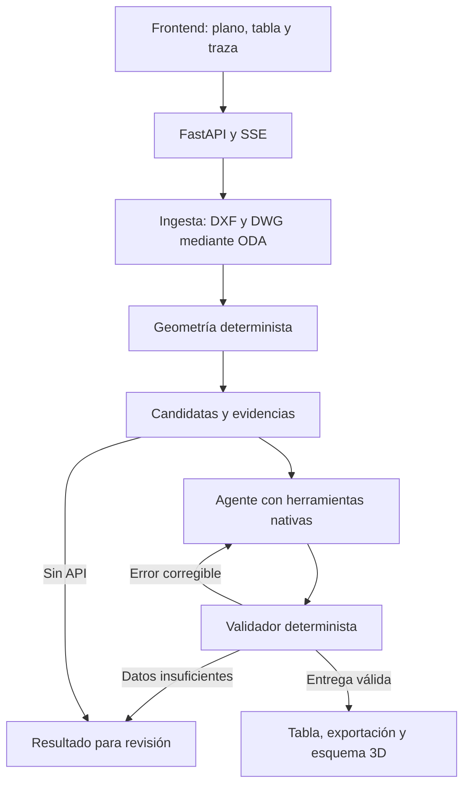

# Vexplorer — plan inicial y decisiones de alcance

> Estado documental (2026-11-14): este archivo conserva requisitos y checkpoints históricos; las frases sobre ausencia de aplicación o contratos pendientes no describen el estado vigente. Consulta [README](README.md) y la auditoría completa. Las reglas de coordinación y arquitectura siguen aplicándose.

## Problema y propuesta

El equipo quiere reducir el tiempo que se dedica a leer planos de mobiliario, identificar componentes, recopilar cotas y preparar una representación comprensible. La entrega objetivo incluye propuestas de piezas y secciones desde planos pobres, con nombre, cantidad, dimensiones, materiales y evidencia o supuestos, revisables por un técnico. Se conecta a las vistas 2D y a una ficha para compras/administración. También recupera muebles históricos similares y explica ajustes de coste y tiempo por medidas, materiales y acabados. La [transcripción](transcripcion-contexto-poc.md) es la fuente de estos requisitos; [CASO_DE_USO_Y_EVALUACION](docs/CASO_DE_USO_Y_EVALUACION.md) fija su evaluación.

El sistema no debe convertir una falta de información en una medida aparente. El valor del MVP es acelerar una lectura verificable y señalar lo que requiere decisión del técnico.

Este documento desarrolla la arquitectura facilitada por el usuario. [CLAUDE.md](CLAUDE.md) conserva sus reglas. Los campos detallados de contratos y API siguen como propuesta pendiente de acuerdo A/B y aviso C. No se ha implementado el backend en esta entrega.

## Arquitectura inicial

El motor geométrico trabaja antes que el agente. La IA propone interpretaciones a partir de candidatas, inspecciona evidencia y termina mediante `entregar_despiece`. El backend comprueba el contrato, las referencias, cantidades y restricciones aplicables, resuelve medidas y conserva el resultado.

El bucle debe ser pequeño y explícito. La referencia de «unas 50 líneas» se aplica a su control central; no es una estimación de toda la validación, persistencia, herramientas y manejo de errores. No se incorporan frameworks pesados de agentes.

## Decisiones que se mantienen

1. Geometría y validador puros y deterministas; ninguna llamada LLM dentro de ellos.
2. Pydantic como fuente de contratos; salida estructurada mediante herramienta.
3. Trazabilidad por entidad, contorno, observación y candidata.
4. Errores reparables devueltos al agente; evidencia ausente termina en revisión.
5. Máximos de llamadas, herramientas, reparaciones y tiempo.
6. Modo geométrico y replay grabado, ambos identificados en pantalla.
7. Frontend JS/HTML independiente; three.js para cajas respaldadas, rotuladas como esquema.
8. MCP queda como extensión después de completar el recorrido principal.

## Ajuste al dataset nuevo

Las prioridades P0/P1 siguientes corresponden al hito técnico. No sustituyen T11–T13: la prueba de concepto completa requiere mobiliario emparejado, propuestas desde planos pobres y recuperación histórica con estimación.

`engineering-drawings-harness.zip` contiene planos mecánicos y combina piezas CAD aisladas con conjuntos en PDF. Se conserva como corpus auxiliar de pruebas técnicas. No contiene un benchmark completo de conjuntos de muebles DWG/DXF con todas sus piezas anotadas.

| Prioridad | Entrega | Datos que la prueban |
|---|---|---|
| P0 | Leer DXF, unidades, cotas lineales, fuentes y revisión | Casos seleccionados de Orla y fixtures propios |
| P0 | Despiece limitado de paneles con identidad y medidas suficientes | Fixture de mobiliario propio, revisado y marcado sintético |
| P0 | Abstenerse ante datos insuficientes o geometría fuera de alcance | Variantes incompletas, conflictos y CAD mecánico no soportado |
| P1 | Convertir DWG si ODA está disponible | Pares DWG/DXF del mismo componente |
| P1 | Piloto de lectura conjunto–detalle en PDF | Bench Vise, con BOM 12 referencias/22 unidades y Jaw Pad |
| P2 | Ampliar familias, MCP y geometría más rica | Nuevas muestras admitidas y anotadas |

PDF de entrada y PDF de exportación son tareas distintas. El primero necesita procedencia por página/región, interpretación de cotas y asociación de referencias; el segundo es presentación de un resultado ya validado. STEP queda como referencia de evaluación separada, no como entrada oculta del modo «solo plano».

## Qué no demuestra la demo P0

Las cotas de una pieza mecánica aislada no demuestran reconstrucción de un conjunto. Una caja 3D no demuestra el mecanizado de taladros, roscas o ensambles. Los datos mecánicos no prueban todavía semántica de mobiliario. La demo debe mostrar con claridad qué recorrido es real CAD y cuál utiliza un fixture propio.

## Primera integración y reparto

- A entrega unidades, entidades, contornos, mediciones y candidatas con evidencia.
- B entrega modelos Pydantic, herramientas, validador, persistencia y harness.
- C entrega plano, tabla, traza y revisión conectados por IDs.
- D, si existe, prepara oráculos independientes, selección, demo y vídeo.

Antes de modificar contratos, A/B registran acuerdo explícito y se avisa a C. Antes de editar código, cada persona declara identidad, archivo y alcance según [team/README.md](team/README.md). Las carpetas de aplicación se crean cuando exista trabajo real que ubicarlas, no vacías por anticipado.

## Documentos de ejecución

[PLAN.md](PLAN.md) divide el trabajo en T1–T10 (hito técnico) y T11–T13 (inferencia, histórico, estimación y aceptación de negocio). [ARQUITECTURA](docs/ARQUITECTURA.md) describe el flujo completo; [DATASET](docs/DATASET.md) conserva la evidencia; [ADAPTACION_DATASET](docs/ADAPTACION_DATASET.md) explica cómo aprovecharla sin mezclar tareas. [TDD](docs/TDD.md) y [TEST_PLAN](docs/TEST_PLAN.md) fijan las comprobaciones antes de implementar.

## Incorporación verificada de mobiliario

La descarga de [PlankAssembly](docs/PLANKASSEMBLY.md) permite preparar T11 con referencias paramétricas de tableros. El siguiente entregable es una muestra de vistas 2D del conjunto con respuesta privada y unidades controladas, no un entrenamiento masivo ni un visor 3D como sustituto del plano. Esta preparación está pendiente y debe encajar con sus condiciones de uso. Los fixtures propios mantienen su función de oráculo independiente; Orla y Bench Vise siguen como controles técnicos. T12 necesita histórico económico adicional y T13 planos/tiempos reales del equipo.
